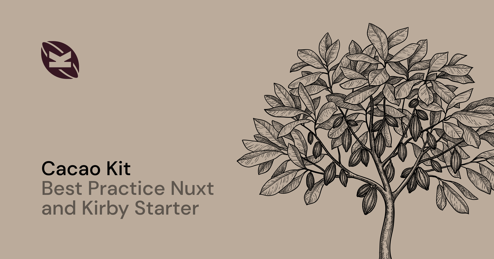
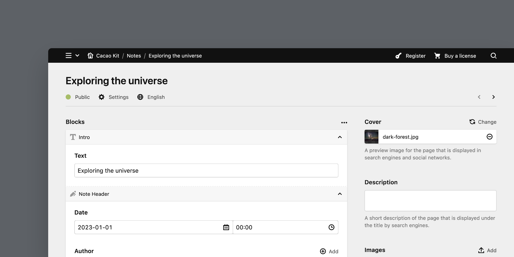

<div align="center">

[](https://cacao-kit.byjohann.dev)

# Cacao Kit (Backend)

A headless Kirby CMS starter where **everything is a block**.

[Development](#development) •
[Cookbook](#cookbook) •
[Deployment](#deployment)

</div>

## When to Use

| If you want to…                                   | This starter provides…                                                   |
| ------------------------------------------------- | ------------------------------------------------------------------------ |
| Build a headless Kirby + Nuxt site                | Pre-configured [Kirby Headless](https://kirby.tools/docs/headless) setup |
| Use Kirby's page structure as the source of truth | Block-first architecture with layouts                                    |
| Avoid duplicating routes in your frontend         | Single page query that works for all pages                               |
| Still use custom blueprints when needed           | Flexibility to create custom Nuxt pages with KQL                         |

## Key Features

- 🧱 Blocks resolved on the server: file UUIDs to image objects, permalinks to URLs
- 🔐 KQL endpoint behind bearer token authentication
- 🌐 Multi-language content in English and German
- 👀 Panel preview button that opens the frontend
- 📁 `public/` web root with content, accounts, and cache outside it in `storage/`

## Architecture

This starter is based on the [Kirby Headless Starter](https://github.com/johannschopplich/kirby-headless-starter) and pairs with the [Cacao Kit frontend](https://github.com/johannschopplich/cacao-kit-frontend).

**Block-first approach:** Every page-related component is a block. The frontend fetches the same page query for every page and renders blocks or layouts accordingly. The backend defines the content structure, so routing doesn't need to be re-implemented in the frontend.

Two field blueprints define the blocks that are available: the [`blocks` field](./site/blueprints/fields/blocks.yml) blueprint for the pages built from blocks and the [`layouts` field](./site/blueprints/fields/layouts.yml) blueprint for the pages built from layouts. Each keeps its own list of Kirby's built-in blocks and custom ones like a notes grid.

[`site/config/blocks-resolver.php`](./site/config/blocks-resolver.php) shapes a block's JSON when a query calls [`toResolvedBlocks()`](https://kirby.tools/docs/headless/usage/field-methods#toresolvedblocks) or `toResolvedLayouts()`, as the frontend's page query does. A resolver under `<block>:<field>` replaces that field's value, such as `text:text`, which turns permalinks into URLs – see [Custom Resolvers](https://kirby.tools/docs/headless/usage/field-methods#custom-resolvers) for the syntax.

You can also use custom Kirby fields in your blueprints and create dedicated Nuxt pages with custom KQL queries. See the [about page](./site/blueprints/pages/about.yml) for an example.



## Development

Requires PHP 8.2 to 8.5 and [Composer](https://getcomposer.org).

1. Create your `.env` from the example:

   ```bash
   cp .env.development.example .env
   ```

2. Install dependencies:

   ```bash
   composer install
   ```

3. Run the PHP server at `http://localhost:8000` – or use a dev server of your choice (e.g. Laravel Valet):

   ```bash
   composer start
   ```

Set that URL as `KIRBY_BASE_URL` in the frontend. In a browser, every page redirects to the Panel.

[`site/config/config.php`](./site/config/config.php) reads the following variables.

| Variable                      | Default | Effect                                                                                            |
| ----------------------------- | ------- | ------------------------------------------------------------------------------------------------- |
| `KIRBY_DEBUG`                 | `false` | Turns on Kirby's debug mode                                                                       |
| `KIRBY_PANEL_INSTALL`         | `false` | Allows the Panel installer on a public server                                                     |
| `KIRBY_PANEL_SLUG`            | `panel` | Path of the Panel                                                                                 |
| `KIRBY_CACHE`                 | `false` | Caches KQL responses                                                                              |
| `KIRBY_MULTILANG`             | `false` | Turns on the languages in [`site/languages`](./site/languages/)                                   |
| `KIRBY_HEADLESS_API_TOKEN`    | –       | Bearer token of the KQL endpoint, the frontend's `KIRBY_API_TOKEN`                                |
| `KIRBY_HEADLESS_FRONTEND_URL` | –       | Frontend URL the Panel's preview button opens                                                     |
| `KIRBY_CORS_ALLOW_ORIGIN`     | `*`     | Origin allowed to send requests. Set the frontend's origin instead of the wildcard for production |

Linting and formatting run through pnpm: `pnpm install`, then `pnpm run lint` or `pnpm run format`.

Kirby is not free software – you can try it as long as you need to, but [buy a license](https://getkirby.com/buy) once you take a project to production.

## Cookbook

### Add a New Block

1. Create a new blueprint in [`site/blueprints/blocks`](./site/blueprints/blocks/)
2. Add the block to the [`blocks` field](./site/blueprints/fields/blocks.yml) blueprint, and to the [`layouts` field](./site/blueprints/fields/layouts.yml) blueprint for the pages built from layouts
3. To send something other than the raw field values, add a `<block>:<field>` resolver to [`site/config/blocks-resolver.php`](./site/config/blocks-resolver.php)
4. Follow the [frontend block guide](https://github.com/johannschopplich/cacao-kit-frontend#add-a-new-block) to create the matching component

> [!NOTE]
> If the block contains a `files` field and you want to resolve image UUIDs to file objects, see the [`toResolvedBlocks()` field method guide](https://kirby.tools/docs/headless/usage/field-methods#toresolvedblocks).

### Add a Page Blueprint

1. Create the blueprint in [`site/blueprints/pages`](./site/blueprints/pages/). Name its blocks field `blocks` or its layout field `layouts` – the frontend's page query reads those two
2. Set the `preview` option, or the Panel's preview button opens the backend, which redirects to the Panel:

   ```yaml
   options:
     preview: "{{ page.frontendUrl }}"
   ```

3. For custom fields, create a dedicated Nuxt page with its own query, as in [Add a KQL Query](https://github.com/johannschopplich/cacao-kit-frontend#add-a-kql-query)

### Commit a Plugin of Your Own

`.gitignore` excludes everything in `site/plugins/`, where Composer installs Kirby Headless and KQL. Add an exception for a plugin you write:

```gitignore
!/site/plugins/my-plugin
```

## Deployment

Point the server's web root at `public/`. Kirby writes to `storage/` and `public/media/`, and to `site/config/` when you register the license in the Panel, so the web server needs write access there. Create the server's `.env` from `.env.production.example` and set your own token, frontend URL, and CORS origin.

Pushes to `main` deploy through [`.github/workflows/deploy.yml`](./.github/workflows/deploy.yml). The workflow opens an SSH connection to `DEPLOY_HOST` and sends no command, so the server decides what a deploy does. A copy without the `DEPLOY_HOST` repository variable skips the job. To deploy from your copy:

1. On the server, add a deploy key to `authorized_keys` with a forced command (`command="…"`) that updates the site, for example by pulling the repository and running `composer install`
2. Set the repository secret `DEPLOY_SSH_KEY` to that key's private half
3. Set the repository variable `DEPLOY_HOST` to the server's host name
4. Set the repository variable `DEPLOY_KNOWN_HOSTS` to the output of `ssh-keyscan <host>`
5. Replace the SSH user `johann` in the workflow with your own

> [!NOTE]
> Some hosting environments require uncommenting `RewriteBase /` in [`.htaccess`](./public/.htaccess) to make site links work.

## License

[MIT](./LICENSE) License © 2023-PRESENT [Johann Schopplich](https://github.com/johannschopplich)
